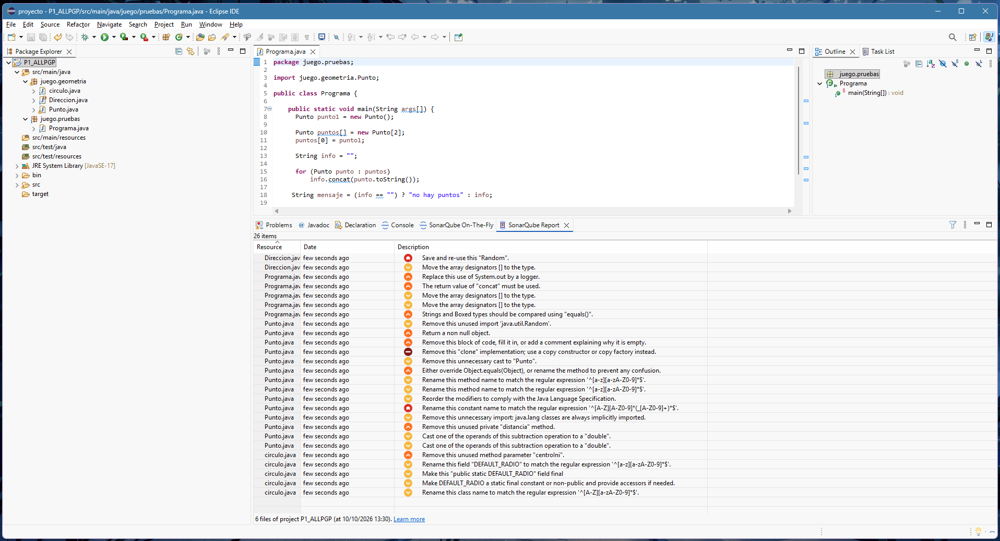
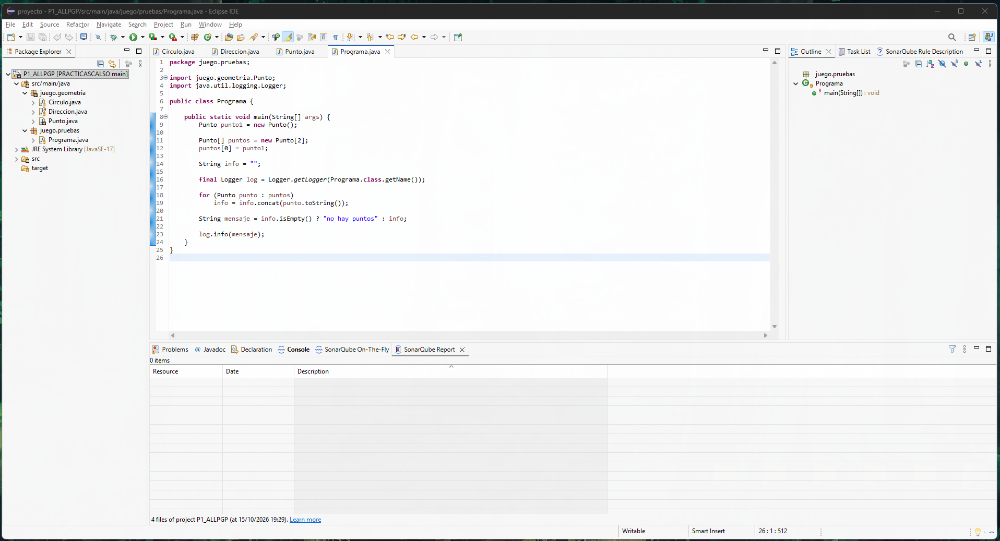

# Práctica 1 — Revisiones estáticas de código con SonarQube for Eclipse

## Índice

- [1. Miembros del grupo](#1-miembros-del-grupo)
- [2. Análisis inicial](#2-análisis-inicial)
- [3. Disconformidades detectadas](#3-disconformidades-detectadas)
- [4. Soluciones adoptadas](#4-soluciones-adoptadas)
- [5. Resumen de las correcciones](#5-resumen-de-las-correcciones)
- [6. Análisis final](#6-análisis-final)
- [7. Proyecto final](#7-proyecto-final)
- [8. Comprobación de la entrega](#8-comprobación-de-la-entrega)

## 1. Miembros del grupo

| Miembro | Nombre y apellidos |
|---|---|
| Alumno/a 1 | ÁLVARO LARA LARA |
| Alumno/a 2 | PABLO GARCÍA PÉREZ |

**Nombre del proyecto Eclipse:** `P1_ALLPGP`

---

## 2. Análisis inicial

Antes de realizar ninguna modificación sobre el código proporcionado se ha ejecutado el análisis estático del proyecto utilizando **SonarQube for Eclipse** con su configuración por defecto.

### Captura inicial



---

## 3. Disconformidades detectadas

En el análisis inicial se han identificado las siguientes disconformidades:

| Nº | Regla Sonar | Archivo | Línea | Disconformidad |
|---:|---|---|---:|---|
| 1 | `java:S2119` | `Direccion.java` | 21 | Save and re-use this "Random" |
| 2 | `java:S1197` | `Direccion.java` | 19 | Move the array designators `[]` to the type |
| 3 | `java:S106` | `Programa.java` | 20 | Replace this use of System.out by a logger |
| 4 | `java:S1481` | `Programa.java` | 16 | The return value of "concat" must be used |
| 5 | `java:S1197` | `Programa.java` | 10 | Move the array designators `[]` to the type |
| 6 | `java:S1197` | `Programa.java` | 7 | Move the array designators `[]` to the type |
| 7 | `java:S4973` | `Programa.java` | 18 | Strings and Boxed types should be compared using "equals()" |
| 8 | `java:S1128` | `Punto.java` | 4 | Remove this unused import 'java.util.Random' |
| 9 | `java:S1168` | `Punto.java` | 145 | Return a non null object |
| 10 | `java:S108` | `Punto.java` | 143 | Remove this block of code, fill it in, or add a comment explaining why it is empty |
| 11 | `java:S2975` | `Punto.java` | 136 | Remove this "clone" implementation; use a copy constructor or copy factory instead |
| 12 | `java:S1905` | `Punto.java` | 130 | Remove this unnecessary cast to "Punto" |
| 13 | `java:S1206` | `Punto.java` | 126 | Either override Object.equals(Object), or rename the method to prevent any confusion |
| 14 | `java:S100` | `Punto.java` | 82 | Rename this method name to match the regular expression '^[a-z][a-zA-Z0-9]*$' |
| 15 | `java:S100` | `Punto.java` | 51 | Rename this method name to match the regular expression '^[a-z][a-zA-Z0-9]*$' |
| 16 | `java:S1124` | `Punto.java` | 11 | Reorder the modifiers to comply with the Java Language Specification |
| 17 | `java:S115` | `Punto.java` | 11 | Rename this constant name to match the regular expression '^[A-Z][A-Z0-9]*(_[A-Z0-9]+)*$' |
| 18 | `java:S1128` | `Punto.java` | 3 | Remove this unnecessary import: java.lang classes are always implicitly imported |
| 19 | `java:S1068` | `Punto.java` | 116 | Remove this unused private "distancia" method |
| 20 | `java:S1640` | `Punto.java` | 117 | Cast one of the operands of this subtraction operation to a "double" |
| 21 | `java:S1640` | `Punto.java` | 117 | Cast one of the operands of this subtraction operation to a "double" |
| 22 | `java:S1172` | `circulo.java` | 10 | Remove this unused method parameter "centroIni" |
| 23 | `java:S116` | `circulo.java` | 5 | Rename this field "DEFAULT_RADIO" to match the regular expression '^[a-z][a-zA-Z0-9]*$' |
| 24 | `java:S1444` | `circulo.java` | 5 | Make this "public static DEFAULT_RADIO" field final |
| 25 | `java:S1104` | `circulo.java` | 5 | Make DEFAULT_RADIO a static final constant or non-public and provide accessors if needed |
| 26 | `java:S101` | `circulo.java` | 3 | Rename this class name to match the regular expression '^[A-Z][a-zA-Z0-9]*$' |

---

## 4. Soluciones adoptadas

### Disconformidad 1 — `java:S2119`

**Localización:** `src/main/java/juego/geometria/Direccion.java`, línea 21

**Responsable:** ÁLVARO LARA LARA

**Problema detectado**

Se crea un nuevo objeto `Random` en cada llamada al método `aleatoria()`.

**Solución adoptada**

Extraer el objeto `Random` como constante estática de la clase.

---

### Disconformidad 2 — `java:S1197`

**Localización:** `src/main/java/juego/geometria/Direccion.java`, línea 21

**Responsable:** ÁLVARO LARA LARA

**Problema detectado**

Los corchetes del array están después del nombre de la variable en lugar del tipo.

**Solución adoptada**

Mover los corchetes `[]` al tipo de la variable.

---

### Disconformidad 3 — `java:S106`

**Localización:** `src/main/java/juego/pruebas/Programa.java`, línea 20

**Responsable:** ÁLVARO LARA LARA

**Problema detectado**

Uso de `System.out.println` en lugar de un logger.

**Solución adoptada**

Sustituir `System.out.println` por un Logger.

---

### Disconformidad 4 — `java:S1481`

**Localización:** `src/main/java/juego/pruebas/Programa.java`, línea 19

**Responsable:** ÁLVARO LARA LARA

**Problema detectado**

El valor devuelto por `String.concat()` no se asigna a ninguna variable.

**Solución adoptada**

Asignar el resultado del concat a la variable info.

---

### Disconformidad 5 — `java:S1197`

**Localización:** `src/main/java/juego/pruebas/Programa.java`, línea 11

**Responsable:** ÁLVARO LARA LARA

**Problema detectado**

Los corchetes del array están después del nombre de la variable.

**Solución adoptada**

Mover los corchetes `[]` al tipo de la variable.

---

### Disconformidad 6 — `java:S1197`

**Localización:** `src/main/java/juego/pruebas/Programa.java`, línea 8

**Responsable:** PABLO GARCÍA PÉREZ

**Problema detectado**

Los corchetes `[]` del array están a la derecha del nombre de la variable.

**Solución adoptada**

Se ponen los corchetes `[]` a la derecha del nombre del tipo para seguir la convención.

---

### Disconformidad 7 — `java:S4973`

**Localización:** `src/main/java/juego/pruebas/Programa.java`, línea 17

**Responsable:** ÁLVARO LARA LARA

**Problema detectado**

Comparación de cadenas usando `==` en lugar de `.equals()`.

**Solución adoptada**

Usar `.equals()` o `.isEmpty()` para comparar cadenas.

---

### Disconformidad 8 — `java:S1128`

**Localización:** `src/main/java/juego/geometria/Punto.java`, línea 4

**Responsable:** ÁLVARO LARA LARA

**Problema detectado**

`Import java.util.Random` no utilizado.

**Solución adoptada**

Eliminar la línea de import innecesaria.

---

### Disconformidad 9 — `java:S2225`

**Localización:** `src/main/java/juego/geometria/Punto.java`, línea 144

**Responsable:** ÁLVARO LARA LARA

**Problema detectado**

El método `clone()` devuelve null.

**Solución adoptada**

Lanzar una excepción en lugar de devolver null.

---

### Disconformidad 10 — `java:S108`

**Localización:** `src/main/java/juego/geometria/Punto.java`, línea 142

**Responsable:** ÁLVARO LARA LARA

**Problema detectado**

El bloque de `catch()` del método `clone()` está vacío.

**Solución adoptada**

Se añade contenido para que se lance una excepción.

---

### Disconformidad 11 — `java:S2975`

**Localización:** `src/main/java/juego/geometria/Punto.java`, línea 142

**Responsable:** ÁLVARO LARA LARA

**Problema detectado**

Bloque catch vacío en el método `clone()`.

**Solución adoptada**

Rellenar el bloque catch con una excepción o un comentario justificativo.

---

### Disconformidad 13 — `java:S1201`

**Localización:** `src/main/java/juego/geometria/Punto.java`, línea 125

**Responsable:** ÁLVARO LARA LARA

**Problema detectado**

El método `equals(Punto)` no sobrescribe `Object.equals(Object)`.

**Solución adoptada**

Rellenar el bloque catch con una excepción o un comentario justificativo. Cambiar la firma a `equals(Object obj)` y añadir `@Override`.

---

### Disconformidad 16 — `java:S1124`

**Localización:** `src/main/java/juego/geometria/Punto.java`, línea 10

**Responsable:** ÁLVARO LARA LARA

**Problema detectado**

Los modificadores `public final static` están en orden incorrecto.

**Solución adoptada**

Reordenar los modificadores a `public static final`.

---

### Disconformidad 17 — `java:S115`

**Localización:** `src/main/java/juego/geometria/Punto.java`, línea 10

**Responsable:** ÁLVARO LARA LARA

**Problema detectado**

El nombre de la constante defaultValue no sigue la convención (debe ser mayúsculas).

**Solución adoptada**

Renombrar a `DEFAULT_VALUE`.

---

### Disconformidad 22 — `java:S1172`

**Localización:** `src/main/java/juego/geometria/circulo.java`, línea 10

**Responsable:** PABLO GARCÍA PÉREZ

**Problema detectado**

El parámetro `centroIni` no se está usando en el constructor `circulo()`.

**Solución adoptada**

Se asigna el valor de la variable de entrada de la función a la variable `centro` de la clase.

---

### Disconformidad 23 — `java:S116`

**Localización:** `src/main/java/juego/geometria/circulo.java`, línea 5

**Responsable:** PABLO GARCÍA PÉREZ

**Problema detectado**

La variable no encaja con la convención de nombres de Java.

**Solución adoptada**

Al añadir el modificador `final` en la disconformidad 24 esta disconformidad se soluciona automáticamente, ya que ahora el nombre de la variable sigue la convención de nombres de variables globales.

---

### Disconformidad 24 — `java:S1444`

**Localización:** `src/main/java/juego/geometria/circulo.java`, línea 5

**Responsable:** PABLO GARCÍA PÉREZ

**Problema detectado**

La variable global `DEFAULT_RADIO` no cuenta con el modificador `final`.

**Solución adoptada**

Se añade el modificador `final` a la variable.

---

### Disconformidad 25 — `java:S1104`

**Localización:** `src/main/java/juego/geometria/circulo.java`, línea 5

**Responsable:** PABLO GARCÍA PÉREZ

**Problema detectado**

La variable `DEFAULT_RADIO` debería de tener los modificadores propios de una variable global.

**Solución adoptada**

Al añadir los modificadores correspondientes en la disconformidad 24 esta disconformidad se soluciona automáticamente.

---

### Disconformidad 26 — `java:S101`

**Localización:** `src/main/java/juego/geometria/circulo.java`, línea 3

**Responsable:** PABLO GARCÍA PÉREZ

**Problema detectado**

El nombre de la clase y del fichero no sigue la convención de nombres de Java.

**Solución adoptada**

Se modifica el nombre del fichero y de constructores de la clase de `circulo` a `Circulo`.

---

## 5. Resumen de las correcciones

| Nº | Regla Sonar | Responsable | Commit | Resultado |
|---:|---|---|---|---|
| 1 | `java:S2119` | ÁLVARO LARA LARA | `b7a1d59` | Resuelta |
| 2 | `java:S1197` | ÁLVARO LARA LARA | `dc37cdf` y `fd0ce62` | Resuelta |
| 3 | `java:S106` | ÁLVARO LARA LARA | `69112c3` | Resuelta |
| 4 | `java:S1481` | ÁLVARO LARA LARA | `5cd59d5` | Resuelta |
| 5 | `java:S1197` | ÁLVARO LARA LARA | `e9f55e1` | Resuelta |
| 6 | `java:S1197` | PABLO GARCÍA PÉREZ | `1a2e802` | Resuelta |
| 7 | `java:S4973` | ÁLVARO LARA LARA | `71795d9` | Resuelta |
| 8 | `java:S1128` | ÁLVARO LARA LARA | `58088d4` | Resuelta |
| 9 | `java:S2225` | ÁLVARO LARA LARA | `aadbbc0` | Resuelta |
| 10 | `java:S108` | ÁLVARO LARA LARA | `aadbbc0` | Resuelta |
| 11 | `java:S2975` | ÁLVARO LARA LARA | `aadbbc0` | Pendiente... |
| 12 | `java:xxxx` | x | `xxxxx` | x |
| 13 | `java:S1201` | ÁLVARO LARA LARA | `aadbbc0` | Resuelta |
| 14 | `java:xxxx` | x | `xxxxx` | x |
| 15 | `java:xxxx` | x | `xxxxx` | x |
| 16 | `java:S1124` | ÁLVARO LARA LARA | `9af31af` | Resuelta |
| 17 | `java:S115` | ÁLVARO LARA LARA | `9af31af` | Resuelta |
| 18 | `java:xxxx` | x | `xxxxx` | x |
| 19 | `java:xxxx` | x | `xxxxx` | x |
| 20 | `java:xxxx` | x | `xxxxx` | x |
| 21 | `java:xxxx` | x | `xxxxx` | x |
| 22 | `java:S1172` | PABLO GARCÍA PÉREZ | `338a129` | Resuelta |
| 23 | `java:S116` | PABLO GARCÍA PÉREZ | `bf081b2` | Resuelta |
| 24 | `java:S1444` | PABLO GARCÍA PÉREZ | `259b249` | Resuelta |
| 25 | `java:S1104` | PABLO GARCÍA PÉREZ | `0ea59e0` | Resuelta |
| 26 | `java:S101` | PABLO GARCÍA PÉREZ | `aca98ba` | Resuelta |

---

## 6. Análisis final

Una vez realizadas todas las modificaciones se ha vuelto a ejecutar el análisis del proyecto completo con **SonarQube for Eclipse**.

### Captura final



La captura final permite comprobar que se está analizando el mismo proyecto utilizado en la captura inicial y que ya no quedan disconformidades pendientes.

---

## 7. Proyecto final

La versión final del proyecto Eclipse se encuentra en:

```text
P1/proyecto/P1_ALLPGP/
```

El proyecto incluido en esta carpeta contiene las modificaciones correspondientes a las soluciones documentadas anteriormente y coincide con la versión sobre la que se ha realizado la captura final.

---

## 8. Comprobación de la entrega

- [x] El nombre del proyecto sigue el formato establecido: `P1_ALLPGP`.
- [x] Se identifican los dos miembros del grupo.
- [x] Se incluye la captura del análisis inicial.
- [x] Se han documentado todas las disconformidades inicialmente detectadas.
- [ ] Cada solución está asociada a un commit identificable en `main`.
- [ ] Se identifica qué miembro del grupo realizó cada corrección.
- [x] Los dos miembros han participado mediante commits propios.
- [ ] Se incluye la captura del análisis final.
- [ ] La captura final permite comprobar que no quedan disconformidades.
- [x] Se ha incorporado el proyecto Eclipse final dentro de `P1/proyecto/`.
- [ ] El proyecto final corresponde al código analizado en la captura final.
