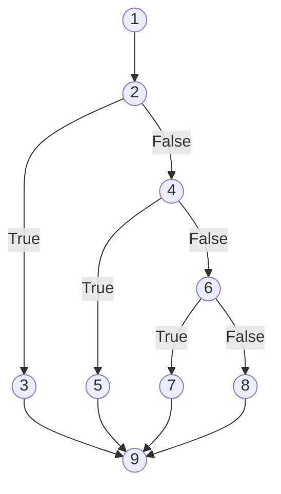
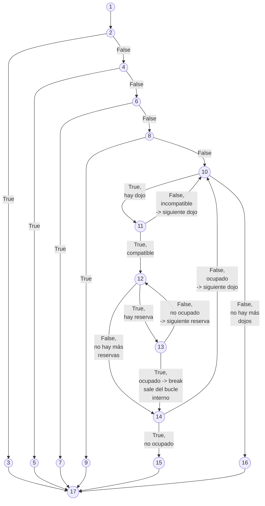
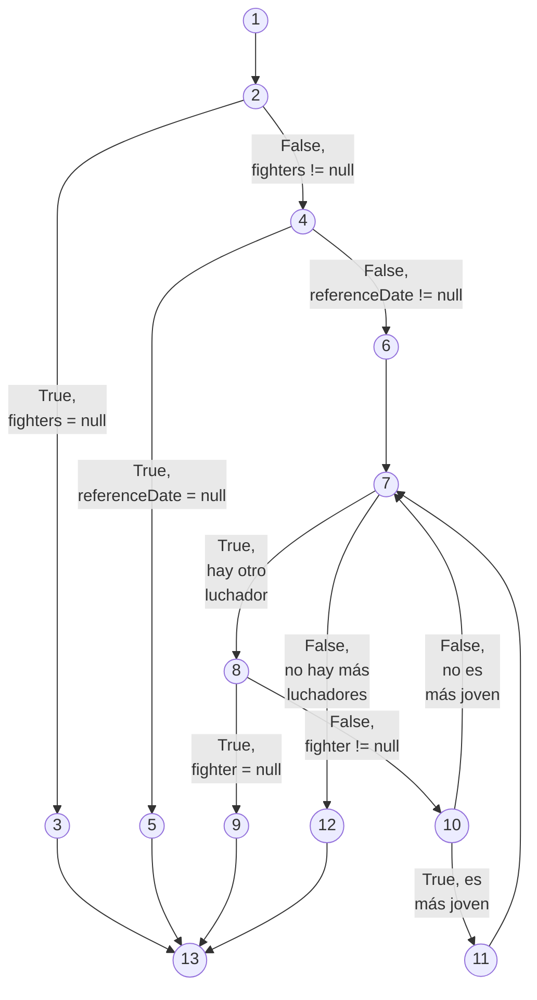
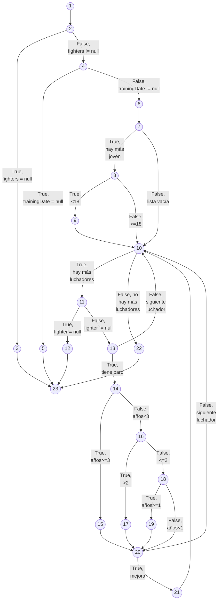

# Práctica 3 — Diseño y ejecución de pruebas de software de caja blanca y de caja negra

---

# Reparto, responsabilidades y enlance video

| Integrante | Caja blanca: métodos de dominio | Caja negra: interfaz | Rama |
|---|---|---| --- |
| **Álvaro Lara Lara (Alumno 1)** | `DojoSearchService.containsAllRequiredWeapons` y `DojoSearchService.findFirstAvailableDojo`  | Búsqueda de dojos (`/dojos`) | main |
| **Pablo García Pérez (Alumno 2)** | `ReservationDiscountService.findYoungestFighter` y `ReservationDiscountService.calculateBestDiscount` | Costes y bonificaciones (`/coste`) | P3-pablo |

**Enlace al vídeo externo (oculto/no listado):** [https://youtu.be/w0ZtG5SBqFw](https://youtu.be/w0ZtG5SBqFw)

---

# Actividad 1 - Pruebas de caja blanca

## Álvaro Lara Lara (Alumno 1)

### 1. Método `DojoSearchService.containsAllRequiredWeapons`

#### 1.1 Código analizado

```java
public boolean containsAllRequiredWeapons(Set<Weapon> available, Set<Weapon> required) {
    if (available == null) {                    // D1
        throw new NullPointerException("Available weapons are required");
    }
    if (required == null) {                     // D2
        throw new NullPointerException("Required weapons are required");
    }
    for (Weapon weapon : required) {            // D3 (bucle)
        if (available.isEmpty()) {              // D4
            return false;
        }
    }
    return true;
}
```

#### 1.2 Grafo de flujo

| Nodo | Contenido |
| -- | -- |
| 1 | entrada |
| 2 | D1: available == null |
| 3 | throw NPE "Available weapons are required" |
| 4 | D2: required == null |
| 5 | throw NPE "Required weapons are required" |
| 6 | D3: available.containsAll(required) |
| 7 | return true (D3 verdadero) |
| 8 | return false (D3 falso) |
| 9 | fin |



#### 1.3 Complejidad ciclomática

| Fórmula | Cálculo | Resultado |
| --- | --- | --- |
| Predicados + 1 | 3 + 1 | 4 |
| Aristas - Nodos + 2 | 11 - 9 + 2 | 4 |
| Regiones | exterior + 3 internas | 4 |

V(G) = 4. Las tres fórmulas coinciden.

#### 1.4 Base de caminos independientes

| Camino | Recorrido | ¿Factible? | Justificación |
| --- | --- | --- | --- |
| C1 | 1-2-3-9 | Sí | available == null |
| C2 | 1-2-4-5-9 | Sí | required == null con available válido |
| C3 | 1-2-4-6-7-9 | Sí | todas las requeridas presentes (o required vacío) -> true |
| C4 | 1-2-4-6-8-9 | Sí | falta alguna requerida -> false |

Los 4 caminos son factibles y cubren las 11 aristas. V(G) = 4 = tamaño de la base.

#### 1.5 Tests con JUnit 5

En `es.um.calso.dojoreservation.domain.service.DojoSearchServiceWeaponsTest.java`.

---

### 2. Método `DojoSearchService.findFirstAvailableDojo`

#### 2.1 Código analizado

```java
public Optional<Dojo> findFirstAvailableDojo(
        List<Dojo> dojos, Set<Weapon> requiredWeapons,
        List<Reservation> reservations, LocalDate trainingDate) {
    if (dojos == null) throw new NPE("Dojos are required");            // D1
    if (requiredWeapons == null) throw new NPE("Required weapons are required"); // D2
    if (reservations == null) throw new NPE("Reservations are required"); // D3
    if (trainingDate == null) throw new NPE("Training date is required"); // D4

    for (Dojo dojo : dojos) {                                          // D5 (bucle externo)
        if (containsAllRequiredWeapons(dojo.weapons(), requiredWeapons)) { // D6
            boolean occupied = false;                                  // N
            for (Reservation reservation : reservations) {             // D7 (bucle interno)
                if (reservation.dojoId().equals(dojo.id())           // D8a
                        && !reservation.trainingDate().equals(trainingDate)) { // D8b
                    occupied = true;
                    break;                                             // D9
                }
            }
            if (!occupied) {                                           // D10
                return Optional.of(dojo);                              // D11
            }
        }
    }
    return Optional.empty();                                           // D12
}
```

#### 2.2 Grafo de flujo

Nodos:

| Nodo | Contenido |
| -- | -- |
| 1 | entrada
| 2 | D1: dojos == null
| 3 | throw NPE "Dojos are required"
| 4 | D2: requiredWeapons == null
| 5 | throw NPE "Required weapons are required"
| 6 | D3: reservations == null
| 7 | throw NPE "Reservations are required"
| 8 | D4: trainingDate == null
| 9 | throw NPE "Training date is required"
| 10 | D5: bucle externo — ¿hay dojo?
| 11 | D6: containsAllRequiredWeapons(...)
| 12 | D7: bucle interno — ¿hay reserva?
| 13 | D8: r.dojoId().equals(dojo.id()) && !r.trainingDate().| equals(trainingDate)
| 14 | D10: !occupied
| 15 | return Optional.of(dojo)
| 16 | return Optional.empty()
| 17 | fin



#### 2.3 Complejidad ciclomática

- N = 17 nodos
- A = 27 aristas
- Predicados = D1, D2, D3, D4, D5, D6, D7, D8, D10 = 9

| Fórmula | Cálculo | Resultado |
| --- | --- | --- |
| Predicados + 1 | 9 + 1 | 10 |
| Aristas - Nodos + 2 | 27 - 17 +2| 12 |
| Regiones | exterior + 9 internas | 10 |

Discrepancia: A − N + 2 da 12 porque el break introduce la arista 13->14, que sale del bucle interno sin pasar por su condición de terminación (12->14). Esa arista rompe la estructura propiamente anidada (properly nested) que asume la fórmula A − N + 2; por eso esa fórmula no es aplicable cuando hay break/continue/return internos.

V(G) = 10, que coincide por la definición de McCabe (nodos con ≥2 aristas de salida + 1) y por el recuento de regiones, y es el número de caminos linealmente independientes.

#### 2.4 Base de caminos independientes

| Camino | Recorrido | ¿Factible? | Justificación |
| --- | --- | --- | --- |
| C1 | 1-2-3-17 | Sí | dojos == null |
| C2 | 1-2-4-5-17 | Sí | dojos válido, requiredWeapons == null |
| C3 | 1-2-4-6-7-17 | Sí | reservations == null |
| C4 | 1-2-4-6-8-9-17 | Sí | trainingDate == null |
| C5 | 1-2-4-6-8-10-16-17 | Sí | lista de dojos vacía |
| C6 | 1-2-4-6-8-10-11-10-16-17 | Sí | dojo incompatible -> siguiente -> agotado |
| C7 | 1-2-4-6-8-10-11-12-14-15-17 | Sí | compatible, sin reservas -> devuelve |
| C8 | 1-2-4-6-8-10-11-12-13-12-14-15-17 | Sí | reserva no ocupante (A=false o B=false) -> siguiente reserva -> fin -> devuelve |
| C9 | 1-2-4-6-8-10-11-12-13-14-10-16-17 | Sí | reserva ocupante (A=T,B=T) -> break -> siguiente dojo -> agotado |
| C10 | 1-2-4-6-8-10-11-12-13-14-10-11-12-14-15-17 | Sí | primer dojo ocupado, segundo compatible y libre -> devuelve segundo |

Los 10 caminos son factibles y cubren las 27 aristas. V(G) = 10 = tamaño de la base. 

#### 2.5 Trazabilidad camino -> test

| Camino | Test JUnit |
| --- | --- |
| C1 | testGivenNullDojosWhenFindFirstThenNullPointerWithMessage |
| C2 | testGivenNullRequiredWeaponsWhenFindFirstThenNullPointerWithMessage |
| C3 | testGivenNullReservationsWhenFindFirstThenNullPointerWithMessage |
| C4 | testGivenNullTrainingDateWhenFindFirstThenNullPointerWithMessage |
| C5 | testGivenEmptyDojosWhenFindFirstThenEmpty |
| C6 | testGivenIncompatibleDojoWhenFindFirstThenEmpty |
| C7 | testGivenCompatibleDojoAndNoReservationsWhenFindFirstThenDojoReturned |
| C8 | testGivenReservationForOtherDojoWhenFindFirstThenDojoReturned, testGivenReservationForSameDojoSameDateWhenFindFirstThenDojoReturned, testGivenReservationForSameDojoOtherDateWhenFindFirstThenDojoReturned |
| C9 | testGivenFirstDojoOccupiedAndSecondIncompatibleWhenFindFirstThenEmpty |
| C10 | testGivenFirstDojoOccupiedAndSecondCompatibleAndFreeWhenFindFirstThenSecondReturned | 

#### 2.6 Cobertura de condiciones seleccionadas

Decisión asignada: reservation.dojoId().equals(dojo.id()) && !reservation.trainingDate().equals(trainingDate) (D8).

Condiciones atómicas:
- A = reservation.dojoId().equals(dojo.id())
- B = !reservation.trainingDate().equals(trainingDate)

| Condición | Caso que evalúa | Caso que evalúa falso | 
| --- | --- | --- |
| A | testGivenReservationForSameDojoOtherDateWhenFindFirstThenDojoReturned (A=T, B=T) | testGivenReservationForOtherDojoWhenFindFirstThenDojoReturned (A=F; B no se evalúa por cortocircuito de &&) |
| B | testGivenReservationForSameDojoOtherDateWhenFindFirstThenDojoReturned (B=T) | testGivenReservationForSameDojoSameDateWhenFindFirstThenDojoReturned (B=F) |

#### 2.7 Tests con JUnit 5

En `es.um.calso.dojoreservation.domain.service.DojoSearchServiceFindFirstTest.java`.

---

### 3. Tabla resumen de trazabilidad

| Método | V(G) | Caminos | Tests implementados | Defecto detectado |
| --- | --- | --- | --- | --- |
| containsAllRequiredWeapons | 5 | C1–C4 | 5 | Ninguno (usa containsAll correctamente) |
| findFirstAvailableDojo | 11 | C1–C10 | 12 | D-1: condición de ocupación usa !equals en la fecha |

---

## Pablo García Pérez (Alumno 2)

### 1. Método `ReservationDiscountService.findYoungestFighter`

#### 1.1 Código analizado

```java
public Optional<Fighter> findYoungestFighter(
        List<Fighter> fighters,
        LocalDate referenceDate) {
    if (fighters == null) {                                             // D1
        throw new NullPointerException("Fighters are required");
    }
    if (referenceDate == null) {                                        // D2
        throw new NullPointerException("Reference date is required");
    }
    Fighter youngest = null;
    for (Fighter fighter : fighters) {                                  // D3 (bucle for)
        if (fighter == null) {                                          // D4
            throw new NullPointerException("Null fighter");
        }
        if (youngest == null || fighter.birthDate().isBefore(youngest.birthDate())) {   // D5
            youngest = fighter;
        }
    }
    return Optional.ofNullable(youngest);
}
```

#### 1.2 Grafo de flujo

| Nodo | Contenido |
| -- | -- |
| 1 | entrada |
| 2 | D1: fighters == null |
| 3 | lanzar NullPointerException "Fighters are required" |
| 4 | D2: referenceDate == null |
| 5 | lanzar NullPointerException "Reference date is required" |
| 6 | Fighter youngest = null |
| 7 | D3: bucle for, por cada luchador en fighters |
| 8 | D4: fighter == null |
| 9 | lanzar NullPointerException "Null fighter" |
| 10 | D5: youngest == null \|\| fighter.birthDate().isBefore(youngest.birthDate()) |
| 11 | youngest = fighter |
| 12 | return Optional.ofNullable(youngest) |
| 13 | fin |



#### 1.3 Complejidad ciclomática

- N = 13 nodos
- A = 17 aristas
- Predicados = D1, D2, D3, D4, D5 = 5

| Fórmula | Cálculo | Resultado |
| -- | -- | -- |
| Predicados + 1 | 5 + 1 | 6 |
| Aristas - Nodos + 2 | 17 - 13 + 2 | 6 |
| Regiones | exterior + 5 internas | 6 |

V(G) = 6. Las tres fórmulas coinciden, teniendo en cuenta que hemos agrupado en D5 `youngest == null` y `fighter.birthDate().isBefore(youngest.birthDate())` en un sólo nodo.

#### 1.4 Base de caminos independientes

| Camino | Recorrido | ¿Factible? | Justificación |
| -- | -- | -- | -- |
| C1 | 1-2-3-13 | Sí | fighters = null |
| C2 | 1-2-4-5-13 | Sí | fighters válido, referenceDate = null |
| C3 | 1-2-4-6-7-12-13 | Sí | lista vacía -> Optional.empty() |
| C4 | 1-2-4-6-7-8-9-13 | Sí | lista con un luchador null -> NullPointerException "Null fighter" |
| C5 | 1-2-4-6-7-8-10-11-7-12-13 | Sí | un luchador: youngest = null es true -> el luchador pasa a ser el más joven |
| C6 | 1-2-4-6-7-8-10-11-7-8-10-7-12-13 | Sí | dos luchadores; el segundo no es más joven (más viejo o misma fecha) -> arista 10->7 |

Los 6 caminos son factibles y cubren las 17 aristas. V(G) = 6 = tamaño de la base.

#### 1.5 Trazabilidad camino -> test

Tests en `es.um.calso.dojoreservation.domain.service.ReservationDiscountServiceFindYoungestFighterTest.java`.

| Camino | Test JUnit |
| -- | -- |
| C1 | testGivenNullFightersWhenFindYoungestThenThrowsNullPointerException |
| C2 | testGivenNullReferenceDateWhenFindYoungestThenThrowsNullPointerException |
| C3 | testGivenEmptyFightersWhenFindYoungestThenResultEmpty |
| C4 | testGivenNullFighterInListWhenFindYoungestThenThrowsNullPointerException |
| C5 | testGivenSingleFighterWhenFindYoungestThenReturnsFighter |
| C6 | testGivenMultipleFightersWhenFindYoungestThenReturnsYoungest |
| Funcional (empate de fecha de macimiento) | testGivenMultipleFightersSameBirthDateWhenFindYoungestThenReturnsFirst |

#### 1.6 Errores corregidos

Se corrige un error en la clase `ReservationDiscountService`. La condición `fighter.birthDate().isBefore(youngest.birthDate())` estaba haciendo que se seleccionara el luchador con más edad de todos y no el más joven, se cambia ``isBefore()`` por `isAfter()` para solucionar esto.

#### 1.7 Cobertura de condiciones seleccionadas

Decisión asignada: `youngest == null || fighter.birthDate().isBefore(youngest.birthDate())`.

Condiciones atómicas:
- A = ``youngest == null``
- B = ``fighter.birthDate().isBefore(youngest.birthDate())``

| Condición atómica | Caso que evalúa verdadero | Caso que evalúa falso | Casos adicionales | Justificación si no es factible |
| -- | -- | -- | -- | -- |
| A | C5: primera iteración (A=true, B no se evalúa por cortocircuito) | C6: segunda iteración (A=false) | Ninguno | - |
| B | C7: `fighters[Ren 1998-06-01, Nora 2009-11-20]`, el segundo nació después (A=false, B=true) | C6: `fighters[Nora 2009-11-20, Ren 1998-06-01]`, el segundo nació antes (A=false, B=false) | C7 | - |

---

### 2. Método `ReservationDiscountService.calculateBestDiscount`

#### 2.1 Código analizado

```java
public Discount calculateBestDiscount(
        List<Fighter> fighters,
        LocalDate trainingDate) {
    if (fighters == null) {                                             // D1
        throw new NullPointerException("Fighters are required");
    }
    if (trainingDate == null) {                                         // D2
        throw new NullPointerException("Training date is required");
    }
    int bestPercentage = 0;
    Optional<Fighter> youngest = findYoungestFighter(fighters, trainingDate);
    if (youngest.isPresent()) {                                         // D3
        int age = youngest.orElseThrow().ageAt(trainingDate);
        if (age < 18) {                                                 // D4
            bestPercentage = 15;
        }
    }
    for (Fighter fighter : fighters) {                                  // D5
        if (fighter == null) {                                          // D6
            throw new NullPointerException("Null fighter");
        }
        Optional<UnemploymentPeriod> period = fighter.unemployment();
        if (period.isPresent()) {                                       // D7
            long completeYears = period.orElseThrow().completeYearsAt(trainingDate);
            int unemploymentPercentage = 0;
            if (completeYears >= 3) {                                   // D8
                unemploymentPercentage = 30;
            } else if (completeYears > 2) {                             // D9
                unemploymentPercentage = 20;
            } else if (completeYears >= 1) {                            // D10
                unemploymentPercentage = 10;
            }
            if (unemploymentPercentage > bestPercentage) {              // D11
                bestPercentage = unemploymentPercentage;
            }
        }
    }
    return new Discount(bestPercentage);
}
```

#### 2.2 Grafo de flujo

| Nodo | Contenido |
| -- | -- |
| 1 | entrada |
| 2 | D1: fighters == null |
| 3 | lanzar NullPointerException "Fighters are required" |
| 4 | D2: trainingDate == null |
| 5 | lanzar NullPointerException "Training date is required" |
| 6 | bestPercentage = 0; youngest = findYoungestFighter(fighters, trainingDate); |
| 7 | D3: youngest.isPresent() |
| 8 | age = youngest.orElseThrow().ageAt(trainingDate); D4: age < 18 |
| 9 | bestPercentage = 15 |
| 10 | D5: bucle for, mientras queden luchadores |
| 11 | D6: fighter == null |
| 12 | lanzar NullPointerException "Null fighter" |
| 13 | period = fighter.unemployment(); D7: period.isPresent() |
| 14 | completeYears = period.orElseThrow().completeYearsAt(trainingDate); unemploymentPercentage = 0; D8: completeYears >= 3 |
| 15 | unemploymentPercentage = 30 |
| 16 | D9: completeYears > 2 |
| 17 | unemploymentPercentage = 20 |
| 18 | D10: completeYears >= 1 |
| 19 | unemploymentPercentage = 10 |
| 20 | D11: unemploymentPercentage > bestPercentage |
| 21 | bestPercentage = unemploymentPercentage |
| 22 | return new Discount(bestPercentage) |
| 23 | fin |



#### 2.3 Complejidad ciclomática

- N = 23 nodos
- A = 33 aristas
- Predicados = D1 a D11 = 11.

| Fórmula | Cálculo | Resultado |
| -- | -- | -- |
| Predicados + 1 | 11 + 1 | 12 |
| Aristas - Nodos + 2 | 33 - 23 + 2 | 12 |
| Regiones | exterior + 11 internas | 12 |

V(G) = 12. Las tres fórmulas coinciden.

#### 2.4 Base de caminos independientes

| Camino | Recorrido | ¿Factible? | Datos y resultado esperado (según especificación) |
| -- | -- | -- | -- |
| C1 | 1-2-3-23 | Sí | fighters = null -> NullPointerException “Fighters are required” |
| C2 | 1-2-4-5-23 | Sí | [Ren 1998-06-01], trainingDate = null -> NullPointerException “Training date is required” |
| C3 | 1-2-4-6-7-10-22-23 | Sí | lista vacía -> Discount(0) |
| C4 | 1-2-4-6-7-8-10-11-13-10-22-23 | Sí | [Ren 1998-06-01] (28 años, sin paro) -> 0 % |
| C5 | 1-2-4-6-7-8-9-10-11-13-10-22-23 | Sí | [Nora 2009-11-20] (17 años) -> 15 % |
| C6 | 1-2-4-6-7-8-10-11-12-23 | No | El camino C6 no es factible debido a que el método ``findYoungestFighter`` (nodo 6) recorre la misma lista de luchadores y lanza un NullPointerException antes de llegar al nodo 12 en caso de que exista un luchador con valor nulo en la lista. |
| C7 | 1-2-4-6-7-8-10-11-13-14-16-18-20-10-22-23 | Sí | [Akira 2000-01-01, paro desde 2025-11-21] (0 años completos) -> 0 % |
| C8 | 1-2-4-6-7-8-10-11-13-14-15-20-21-10-22-23 | Sí | [Akira 2000-01-01, paro desde 2023-11-20] (3 años) -> 30 % |
| C9 | 1-2-4-6-7-8-10-11-13-14-16-17-20-21-10-22-23 | Sí | [Akira 2000-01-01, paro desde 2024-11-20] (2 años) -> 20 % |
| C10 | 1-2-4-6-7-8-10-11-13-14-16-18-19-20-21-10-22-23 | Sí | [Akira 2000-01-01, paro desde 2025-11-20] (1 año) -> 10 % |
| C11 | 1-2-4-6-7-8-10-11-13-10-11-13-10-22-23 | Sí | [Ren 1998-06-01, Akira 2000-01-01], sin paro (dos iteraciones) -> 0 % |
| C12 | 1-2-4-6-7-8-9-10-11-13-14-16-18-19-20-10-22-23 | Sí | [Nora 2009-11-20, paro desde 2025-11-20] -> juventud 15 %, paro 10 %, solo se aplica el mayor -> 15 % |

Los 12 caminos son factibles y cubren las 33 aristas. V(G) = 12 = tamaño de la base.

#### 2.5 Trazabilidad camino -> test

Tests en `es.um.calso.dojoreservation.domain.service.ReservationDiscountServiceCalculateBestDiscountTest.java`.

| Camino | Test JUnit |
| -- | -- |
| C1 | testGivenNullFightersWhenCalculateBestDiscountThenThrowsNullPointerException |
| C2 | testGivenNullTrainingDateWhenCalculateBestDiscountThenThrowsNullPointerException |
| C3 | testGivenEmptyFightersWhenCalculateBestDiscountThenZeroPercent |
| C4 | testGivenAdultWithoutUnemploymentWhenCalculateBestDiscountThenZeroPercent |
| C5 | testGivenSeventeenYearOldFighterWhenCalculateBestDiscountThenFifteenPercent |
| C6 | No factible |
| C7 | testGivenZeroCompleteYearsUnemploymentWhenCalculateBestDiscountThenZeroPercent |
| C8 | testGivenThreeYearsUnemploymentWhenCalculateBestDiscountThenThirtyPercent |
| C9 | testGivenTwoYearsUnemploymentWhenCalculateBestDiscountThenTwentyPercent |
| C10 | testGivenOneYearUnemploymentWhenCalculateBestDiscountThenTenPercent |
| C11 | testGivenTwoAdultsWithoutUnemploymentWhenCalculateBestDiscountThenZeroPercent |
| C12 | testGivenSeventeenYearOldWithOneYearUnemploymentWhenCalculateBestDiscountThenFifteenPercent |

#### 2.6 Errores corregidos

Se corrigen dos errores en el método `calculateBestDiscount` de la clase `ReservationDiscountService`.
- En el primero la condición `else if (completeYears > 2)` no contempla la opción de que la cantidad de años sea exactamente 2, por lo que ajustamos este condicional a `else if (completeYears >= 2)`.
- En el segundo la condición al comienzo del bucle for que recorre la colección de luchadores `if (fighter == null)` es código inalcanzable, ya que al usar el método `findYoungestFighter` antes del bucle for en el método actual nunca se va a poder lanzar esta excepción de nuevo en caso de que esta condición sea verdadera, ya que el propio método `findYoungestFighter` implementa esta misma condición al recibir como argumento una colección de luchadores.

---

### 3. Tabla resumen de trazabilidad

| Método | V(G) | Caminos | Tests implementados | Defecto(s) detectado(s) |
| --- | --- | --- | --- | --- |
| findYoungestFighter | 6 | C1-C6 | 6 | `fighter.birthDate().isBefore(youngest.birthDate())` -> `fighter.birthDate().isAfter(youngest.birthDate())` |
| calculateBestDiscount | 12 | C1-C12 (C6 no factible, no se implementa test) | 11 | ``else if (completeYears > 2)`` -> ``else if (completeYears >= 2)`` / eliminar ``if (fighter == null)`` por código inalcanzable |

---

# Actividad 2 - Caja negra con Selenium

## Álvaro Lara Lara (Alumno 1) (`/dojos`)

### 1. Identificación de clases de equivalencia

#### 1.1 Factores de entrada

| Factor | Descripción | Dominio |
| --- | --- | --- |
| F1 | teamId | Identificadores conocidos {EQ-001..EQ-005} o cualquier otra cadena |
| F2 | trainingDate | Fecha ISO AAAA-MM-DD; relación con el reloj fijo (2026-10-20) |
| F3 | Estado de disponibilidad del dojo | Reserva existente con mismo dojoId y misma fecha |
| F4 | Compatibilidad de armas | Dojo contiene todas las armas requeridas del equipo |

#### 1.2 Tabla de clases de equivalencia

| Código | Factor / estado | Condición de pertenencia | Válida / inválida | Comportamiento exigido |
| --- | --- | --- | --- | --- |
| CE1 | F1 teamId | Identificador existente en catálogo (EQ-001..EQ-005) | Válida | Se evalúan los dojos para ese equipo |
| CE2 | F1 teamId | Cadena no vacía pero inexistente (p. ej. EQ-999) | Inválida | Error Team does not exist (#error) |
| CE3 | F1 teamId | Cadena vacía o en blanco ("", " ") | Inválida | Error Team id is required (#error) |
| CE4 | F2 trainingDate | Fecha estrictamente posterior a 2026-10-20 | Válida | Búsqueda normal; tabla de dojos |
| CE5 | F2 trainingDate | Fecha igual a 2026-10-20 (hoy) | Inválida | Error Training date must be in the future (#error) |
| CE6 | F2 trainingDate | Fecha anterior a 2026-10-20 | Inválida | Error Training date must be in the future (#error) |
| CE7 | F2 trainingDate | Formato no ISO (p. ej. 20/11/2026) | Inválida | Rechazo de Spring MVC antes del caso de uso (no mensaje de fecha futura) |
| CE8 | F3 Disponibilidad | Ningún dojo compatible y libre | Válida (resultado vacío) | #no-dojo visible; #dojo-id ausente |
| CE9 | F3 Disponibilidad | Al menos un dojo compatible y libre | Válida (resultado con selección) | #dojo-id visible; fila resaltada selected-row |
| CE10 | F4 Compatibilidad | Dojo con todas las armas requeridas | Válida | Fila con status-ok "Compatible" |
| CE11 | F4 Compatibilidad | Dojo sin todas las armas requeridas | Válida | Fila con status-no "Incompatible" |
| CE12 | F3 Ocupación | Reserva con mismo dojoId y misma fecha | Válida | Fila con status-no "Ocupado" |
| CE13 | F3 Ocupación | Reserva con mismo dojoId pero distinta fecha | Válida | Fila |

#### 1.3 Análisis de valores límite

| Factor | Valor inmediatamente inferior | Valor del límite | Valor inmediatamente superior | Casos elegidos y expectativas |
| --- | --- | --- | --- | --- |
| F2 fecha vs. reloj (2026-10-20) | 2026-10-19 (CE6) | 2026-10-20 (CE5, "hoy") | 2026-10-21 (CE4, "mañana") | 2026-10-19 -> error fecha; 2026-10-20 -> error fecha; 2026-10-21 -> tabla normal |
| F1 teamId longitud | "" (vacío, CE3) | — | "EQ-001" (CE1) | ""/" " -> error id requerido; EQ-001 -> tabla |
| F1 teamId existencia | — | EQ-001..EQ-005 (CE1) | EQ-999 (CE2) | EQ-001 -> tabla; EQ-999 -> error inexistente |
| F3 ocupación | reserva D-001 @ 2027-11-20 (CE13, distinta fecha) | reserva D-001 @ 2026-11-20 (CE12, misma fecha) | — | Con EQ-001 y 2026-11-20 -> D-001 ocupado; con EQ-001 y 2026-11-21 -> D-001 libre |
| F4 compatibilidad | EQ-002 (Bo) contra D-001 (Katana+Bokken, CE11) | EQ-001 (Katana+Bokken) contra D-001 (CE10) |  |  |

#### 1.5 Implementación Selenium

En `es.um.calso.dojoreservation.infrastructure.e2e.DojoSearchE2ETest.java`

#### 1.6 Cobertura de clases de equivalencia

| Clase | Caso(s) | Estado |
| --- | --- | --- |
| CE1 | CN1, CN2, CN3, CN9 | Cubierta |
| CE2 | CN4 | Cubierta |
| CE3 | CN5 | Cubierta |
| CE4 | CN1, CN2, CN3, CN9 | Cubierta |
| CE5 | CN6 | Cubierta |
| CE6 | CN7 | Cubierta |
| CE7 | CN10 | Cubierta |
| CE8 | — | No factible con fixtures fijos; justificada |
| CE9 | CN1, CN2, CN3, CN9 | Cubierta |
| CE10 | CN1, CN3, CN9 | Cubierta |
| CE11 | CN9 | Cubierta |
| CE12 | CN2 | Cubierta |
| CE13 | CN3 | Cubierta (detecta defecto) |

#### 1.7 Trazabilidad clase -> test

| Clase | Test |
| --- | --- |
| CE1, CE4, CE9, CE10 | testGivenDragonTeamTomorrow... |
| CE1, CE4, CE9, CE12 | testGivenNorthDojoBookedForDate... |
| CE1, CE4, CE9, CE13 | testGivenReservationForDifferentDate... |
| CE2 | testGivenUnknownTeam... |
| CE3 | testGivenEmptyTeam... |
| CE5 | testGivenToday... |
| CE6 | testGivenYesterday... |
| CE10, CE11 | testGivenTigerTeam... |
| CE7 | testGivenMalformedDate... |

#### 1.8 Ejecución y resultados

| Test | Resultado | Motivo |
| --- | --- | --- |
| CN1 testGivenDragonTeamTomorrow... | GREEN | D-001 libre y compatible -> seleccionado |
| CN2 testGivenNorthDojoBookedForDate... | GREEN | D-001 ocupado -> D-002 seleccionado |
| CN3 testGivenReservationForDifferentDate... | RED | Defecto: findFirstAvailableDojo trata la reserva de otra fecha como ocupación. #dojo-id = D-002, no D-001; fila D-001 muestra "Ocupado" |
| CN4 testGivenUnknownTeam... | GREEN | #error = "Team does not exist" |
| CN5 testGivenEmptyTeam... | GREEN | #error = "Team id is required" |
| CN6 testGivenToday... | GREEN | #error = "Training date must be in the future" |
| CN7 testGivenYesterday... | GREEN | #error = "Training date must be in the future" |
| CN9 testGivenTigerTeam... | GREEN | D-001 incompatible, D-003 seleccionado |
| CN10 testGivenMalformedDate... | GREEN | Spring MVC devuelve 400; no hay tabla ni error de dominio |

#### 1.9 Defecto detectado (CN3)

Síntoma: al buscar con EQ-001 y 2026-11-21, la fila de D-001 aparece como "Ocupado" y se selecciona D-002, cuando la reserva de D-001 es para 2026-11-20 y 2027-11-20 (fechas distintas).

Causa: en DojoSearchService.findFirstAvailableDojo, la condición !reservation.trainingDate().equals(trainingDate) marca como ocupado cualquier dojo que tenga alguna reserva en otra fecha. La especificación exige bloquear solo cuando coinciden identificador y fecha.

Corrección propuesta:

```java
if (reservation.dojoId().equals(dojo.id())
        && reservation.trainingDate().equals(trainingDate)) {
    occupied = true;
    break;
}
```

Regresión: tras la corrección, CN3 pasa a GREEN; CN1, CN2, CN4–CN7, CN9, CN10 permanecen GREEN. Se repite mvn -Pe2e clean verify y se verifica también la suite unitaria (mvn clean verify).

## Pablo García Pérez (Alumno 2) (`/coste`)

### 2.1 Factores de entrada

| Factor | Descripción | Dominio |
| --- | --- | --- |
| F1 | `teamId` | EQ-001..EQ-005, cualquier otra cadena, o cadena en blanco |
| F2 | `dojoId` | D-001..D-003, cualquier otra cadena, o cadena en blanco |
| F3 | `trainingDate` | Fecha ISO AAAA-MM-DD frente al reloj fijo 2026-10-20, o formato inválido |
| F4 | Armas distintas requeridas por el equipo | 1 arma (EQ-002..EQ-005) o 2 armas (EQ-001). 0 armas no existe en el catálogo |
| F5 | Edad del luchador más joven en la fecha de entrenamiento | < 18 o >= 18 |
| F6 | Años completos de desempleo del luchador con mayor bonificación | sin paro, < 1, [1,2), [2,3), >= 3 |
| F7 | Estado de ocupación del dojo | Libre u ocupado en la fecha (no debe influir en el presupuesto) |

### 2.2 Tabla de clases de equivalencia

| Código | Variable | Condición de pertenencia | Válida / inválida | Comportamiento exigido |
| --- | --- | --- | --- | --- |
| CE1 | teamId | Existe en el catálogo (EQ-001..EQ-005) | Válida | Se calcula el coste |
| CE2 | teamId | No vacío pero inexistente (EQ-999) | Inválida | `#error` = Team does not exist |
| CE3 | teamId | En blanco (`%20`) | Inválida | `#error` = Team id is required |
| CE4 | dojoId | Existe en el catálogo (D-001..D-003) | Válida | Se calcula el coste |
| CE5 | dojoId | No vacío pero inexistente (D-999) | Inválida | `#error` = Dojo does not exist |
| CE6 | dojoId | En blanco (`%20`) | Inválida | `#error` = Dojo id is required |
| CE7 | trainingDate | Estrictamente posterior a 2026-10-20 | Válida | Se calcula el coste |
| CE8 | trainingDate | Igual a 2026-10-20 (hoy) | Inválida | `#error` = Training date must be in the future |
| CE9 | trainingDate | Anterior a 2026-10-20 | Inválida | `#error` = Training date must be in the future |
| CE10 | trainingDate | Formato no ISO (20/11/2026) | Inválida | Spring MVC responde 400 antes del caso de uso |
| CE11 | Armas requeridas | 1 arma | Válida | Suplemento 5,00 € |
| CE12 | Armas requeridas | 2 armas | Válida | Suplemento 10,00 € |
| CE13 | Más joven | Menos de 18 años en la fecha | Válida | Bonificación juvenil 15 % |
| CE14 | Más joven | 18 o más años | Válida | Sin bonificación juvenil |
| CE15 | Desempleo | Sin luchadores en paro | Válida | 0 % |
| CE16 | Desempleo | < 1 año completo | Válida | 0 % |
| CE17 | Desempleo | De 1 a < 2 años | Válida | 10 % |
| CE18 | Desempleo | De 2 a < 3 años | Válida | 20 % |
| CE19 | Desempleo | 3 años o más | Válida | 30 % |
| CE20 | Combinación | Juventud (15 %) mayor que desempleo | Válida | Se aplica 15 %, no se suman |
| CE21 | Combinación | Desempleo mayor que juventud | Válida | Se aplica el porcentaje de paro |
| CE22 | Ocupación | Dojo con reserva en la misma fecha | Válida | El presupuesto se calcula igualmente |

CE-armas con 0 armas no es alcanzable por interfaz (todos los equipos del catálogo requieren al menos 1 arma); se cubre en la prueba unitaria `ReservationPricingServiceTest`.

### 2.3 Valores límite

| Variable | Valor inmediatamente inferior | Valor del límite | Valor inmediatamente superior | Expectativa |
| --- | --- | --- | --- | --- |
| Fecha vs. reloj (2026-10-20) | 2026-10-19 | 2026-10-20 | 2026-10-21 | error / error / cálculo normal |
| Mayoría de edad (Nora, EQ-003, nace 2009-11-20) | 2027-11-19 | 2027-11-20 | — | 15 % / 0 % |
| 1 año de paro (Izan, EQ-004, desde 2025-11-20) | 2026-11-19 | 2026-11-20 | — | 0 % / 10 % |
| 2 años de paro (Izan, EQ-004) | 2027-11-19 | 2027-11-20 | — | 10 % / 20 % |
| 3 años de paro (Lea, EQ-005, desde 2024-11-20) | 2027-11-19 | 2027-11-20 | — | 20 % / 30 % |

### 2.4 Tabla de casos

Datos de referencia: reloj 2026-10-20; suplemento 5 € por arma distinta; D-001 40 €, D-002 50 €, D-003 35 €. Todos los importes se muestran con dos decimales.

| ID | Clases / límite | Entradas (equipo, dojo, fecha) | Estado previo | Resultado único esperado | Test |
| --- | --- | --- | --- | --- | --- |
| CN1 | CE1, CE4, CE7, CE11, CE14, CE15 | EQ-002, D-001, 2026-10-21 | Equipo sin jóvenes ni paro | `#discount` = 0 | testGivenTigerTeamNorthDojoTomorrowWhenCalculateCostThenDiscountIsZero |
| CN2 | idem | EQ-002, D-001, 2026-10-21 | idem | `#final-price` = 45.00 | testGivenTigerTeamNorthDojoTomorrowWhenCalculateCostThenFinalPriceIs45 |
| CN3 | idem, CE11 | EQ-002, D-001, 2026-10-21 | idem | `#weapons-price` = 5.00 | testGivenTigerTeamNorthDojoTomorrowWhenCalculateCostThenWeaponsSupplementIs5 |
| CN4 | CE12 | EQ-001, D-002, 2026-10-21 | Equipo con Katana y Bokken | `#weapons-price` = 10.00 | testGivenDragonTeamCentroDojoTomorrowWhenCalculateCostThenWeaponsSupplementIs10 |
| CN5 | CE12 | EQ-001, D-002, 2026-10-21 | idem | `#subtotal` = 60.00 | testGivenDragonTeamCentroDojoTomorrowWhenCalculateCostThenSubtotalIs60 |
| CN6 | CE13, CE17, CE20 | EQ-001, D-002, 2026-10-21 | Hana 16 años, Akira 1 año de paro | `#discount` = 15 | testGivenDragonTeamCentroDojoTomorrowWhenCalculateCostThenDiscountIs15 |
| CN7 | CE13, CE17, CE20 | EQ-001, D-002, 2026-10-21 | idem | `#final-price` = 51.00 | testGivenDragonTeamCentroDojoTomorrowWhenCalculateCostThenFinalPriceIs51 |
| CN8 | CE14, CE19, CE21 | EQ-001, D-002, 2027-11-20 | Hana 18 años, Akira 3 años de paro | `#discount` = 30 | testGivenDragonTeamCentroDojoOn20Nov2027WhenCalculateCostThenDiscountIs30 |
| CN9 | CE14, CE19, CE21 | EQ-001, D-002, 2027-11-20 | idem | `#final-price` = 42.00 | testGivenDragonTeamCentroDojoOn20Nov2027WhenCalculateCostThenFinalPriceIs42 |
| CN10 | CE22, CE13, CE18, CE21 | EQ-001, D-001, 2026-11-20 | D-001 reservado ese día; Hana 17 años, Akira 2 años de paro | `#final-price` = 40.00 (50 € con 20 %) | testGivenDragonTeamBookedNorthDojoOn20Nov2026WhenCalculateCostThenFinalPriceIs40 |
| CN11 | Límite edad (antes) | EQ-003, D-003, 2027-11-19 | Nora 17 años | `#discount` = 15 | testGivenAgeBoundaryTeamDayBeforeEighteenthBirthdayWhenCalculateCostThenDiscountIs15 |
| CN12 | Límite edad (en) | EQ-003, D-003, 2027-11-20 | Nora 18 años | `#discount` = 0 | testGivenAgeBoundaryTeamEighteenthBirthdayWhenCalculateCostThenDiscountIsZero |
| CN13 | Límite edad (antes) | EQ-003, D-003, 2027-11-19 | Nora 17 años | `#final-price` = 34.00 (40 € con 15 %) | testGivenAgeBoundaryTeamDayBeforeEighteenthBirthdayWhenCalculateCostThenFinalPriceIs34 |
| CN14 | Límite 1 año (antes), CE16 | EQ-004, D-003, 2026-11-19 | Izan 0 años completos | `#discount` = 0 | testGivenTwoYearTeamDayBeforeFirstAnniversaryWhenCalculateCostThenDiscountIsZero |
| CN15 | Límite 1 año (en), CE17 | EQ-004, D-003, 2026-11-20 | Izan 1 año | `#discount` = 10 | testGivenTwoYearTeamFirstAnniversaryWhenCalculateCostThenDiscountIs10 |
| CN16 | Límite 2 años (antes), CE17 | EQ-004, D-003, 2027-11-19 | Izan 1 año | `#discount` = 10 | testGivenTwoYearTeamDayBeforeSecondAnniversaryWhenCalculateCostThenDiscountIs10 |
| CN17 | Límite 2 años (en), CE18 | EQ-004, D-003, 2027-11-20 | Izan 2 años | `#discount` = 20 | testGivenTwoYearTeamSecondAnniversaryWhenCalculateCostThenDiscountIs20 |
| CN18 | Límite 3 años (antes), CE18 | EQ-005, D-003, 2027-11-19 | Lea 2 años | `#discount` = 20 | testGivenThreeYearTeamDayBeforeThirdAnniversaryWhenCalculateCostThenDiscountIs20 |
| CN19 | Límite 3 años (en), CE19 | EQ-005, D-003, 2027-11-20 | Lea 3 años | `#discount` = 30 | testGivenThreeYearTeamThirdAnniversaryWhenCalculateCostThenDiscountIs30 |
| CN20 | CE8 (límite hoy) | EQ-001, D-001, 2026-10-20 | — | `#error` = Training date must be in the future | testGivenTodayWhenCalculateCostThenTrainingDateMustBeFutureError |
| CN21 | CE9 | EQ-001, D-001, 2026-10-19 | — | `#error` = Training date must be in the future | testGivenYesterdayWhenCalculateCostThenTrainingDateMustBeFutureError |
| CN22 | CE2 | `/coste?teamId=EQ-999&dojoId=D-001&trainingDate=2026-11-20` | — | `#error` = Team does not exist | testGivenUnknownTeamWhenCalculateCostThenTeamDoesNotExistError |
| CN23 | CE5 | `/coste?teamId=EQ-001&dojoId=D-999&trainingDate=2026-11-20` | — | `#error` = Dojo does not exist | testGivenUnknownDojoWhenCalculateCostThenDojoDoesNotExistError |
| CN24 | CE3 | `/coste?teamId=%20&dojoId=D-001&trainingDate=2026-11-20` | — | `#error` = Team id is required | testGivenBlankTeamIdWhenCalculateCostThenTeamIdRequiredError |
| CN25 | CE6 | `/coste?teamId=EQ-001&dojoId=%20&trainingDate=2026-11-20` | — | `#error` = Dojo id is required | testGivenBlankDojoIdWhenCalculateCostThenDojoIdRequiredError |
| CN26 | CE10 | `/coste?teamId=EQ-001&dojoId=D-001&trainingDate=20%2F11%2F2026` | — | HTTP 400 de Spring MVC; no hay desglose ni error de dominio | testGivenMalformedDateWhenCalculateCostThenSpringRejectsWithBadRequest |

Cada caso rompe una sola regla de validación: el servidor valida primero teamId, dojoId y fecha, y después la existencia de equipo y dojo, de modo que combinar varios errores enmascararía los demás.

**Observación:** el controlador usa `@RequestParam(defaultValue=...)`, que sustituye un valor vacío (`teamId=`) por EQ-001 (y `dojoId=` por D-002). Por eso los casos de "identificador requerido" se prueban con un valor en blanco (`%20`) y no con cadena vacía.

### 2.5 Implementación Selenium

En `es.um.calso.dojoreservation.infrastructure.e2e.ReservationCostE2ETest.java` (26 métodos, uno por caso).

### 2.6 Cobertura de clases de equivalencia

| Clase | Caso(s) | Estado |
| --- | --- | --- |
| CE1 | CN1–CN21, CN23, CN25, CN26 | Cubierta |
| CE2 | CN22 | Cubierta |
| CE3 | CN24 | Cubierta |
| CE4 | CN1–CN22, CN24 | Cubierta |
| CE5 | CN23 | Cubierta |
| CE6 | CN25 | Cubierta |
| CE7 | CN1–CN19 | Cubierta |
| CE8 | CN20 | Cubierta |
| CE9 | CN21 | Cubierta |
| CE10 | CN26 | Cubierta |
| CE11 | CN1–CN3, CN11–CN19 | Cubierta |
| CE12 | CN4–CN10 | Cubierta |
| CE13 | CN6, CN7, CN10, CN11, CN13 | Cubierta |
| CE14 | CN1–CN5, CN8, CN9, CN12, CN14–CN19 | Cubierta |
| CE15 | CN1–CN5, CN11–CN13 | Cubierta |
| CE16 | CN14 | Cubierta |
| CE17 | CN6, CN7, CN15, CN16 | Cubierta |
| CE18 | CN10, CN17, CN18 | Cubierta |
| CE19 | CN8, CN9, CN19 | Cubierta |
| CE20 | CN6, CN7 | Cubierta |
| CE21 | CN8, CN9, CN10 | Cubierta |
| CE22 | CN10 | Cubierta |

### 2.7 Ejecución y resultados

Comando: `mvn -Pe2e clean verify` (reloj fijo 2026-10-20). Resultados con el código inicial, **antes de corregir** (completa/verifica esta tabla con tu ejecución real):

| Casos | Resultado | Motivo |
| --- | --- | --- |
| CN1–CN5, CN8, CN9, CN12, CN14–CN16, CN19–CN26 | GREEN | El comportamiento coincide con la especificación |
| CN6, CN7, CN11, CN13 | RED | Se esperaba bonificación juvenil del 15 % y no se aplica (o se aplica solo el 10 % de paro): `findYoungestFighter` devuelve al luchador más viejo (`isBefore`) |
| CN17, CN18 | RED | Con exactamente 2 años completos de paro se aplica 10 % en lugar de 20 %: la condición es `completeYears > 2` |
| CN10 | RED | Combina ambos defectos: se obtiene 10 % (45.00 €) en lugar de 20 % (40.00 €) |

Tras aplicar las correcciones: **26/26 GREEN** (sustituye por el número real de tu ejecución).

### 2.8 Defectos detectados desde la interfaz

**D-3 · Bonificación juvenil calculada sobre el luchador más viejo**
- Síntoma: EQ-001 con D-002 el 2026-10-21 muestra 10 % (54.00 €) en vez de 15 % (51.00 €); EQ-003 el 2027-11-19 muestra 0 % en vez de 15 %.
- Prueba que lo detecta: CN6, CN7, CN11, CN13 (E2E) y `testGivenMultipleFightersWhenFindYoungestThenReturnsYoungest` (unitaria).
- Causa: `findYoungestFighter` usaba `birthDate().isBefore(...)`, que conserva la fecha de nacimiento más antigua. La especificación pide la fecha de nacimiento más reciente.
- Corrección: `isBefore` por `isAfter`.

**D-4 · Desempleo de exactamente 2 años no recibe el 20 %**
- Síntoma: EQ-004 el 2027-11-20 y EQ-005 el 2027-11-19 muestran 10 % en vez de 20 %.
- Prueba que lo detecta: CN17, CN18 (E2E) y `testGivenTwoYearsUnemploymentWhenCalculateBestDiscountThenTwentyPercent` (unitaria).
- Causa: la condición `completeYears > 2` excluye el valor 2; la especificación indica de 2 a menos de 3 años → 20 %.
- Corrección: `completeYears > 2` por `completeYears >= 2`.

Regresión posterior: tras cada corrección se repitió `mvn clean verify` y `mvn -Pe2e clean verify`; CN10 solo pasa a GREEN cuando ambas correcciones están aplicadas. (Completa con los resultados reales.)

---

# Actividad 3 - Calidad, defectos y regresión

## 1. Defectos y correcciones 

D-1 · findFirstAvailableDojo marca ocupado un dojo con reserva en otra fecha
Síntoma: al buscar EQ-001 con 2026-11-21, la fila de D-001 aparece "Ocupado" y se selecciona D-002, cuando la reserva de D-001 es de 2026-11-20 y 2027-11-20 (fechas distintas).

Prueba que lo detecta:

Unitaria: testGivenReservationForSameDojoOtherDateWhenFindFirstThenDojoReturned (RED antes de corregir).

E2E: testGivenReservationForDifferentDateWhenSearchThenNorthDojoIsFree (CN3, RED antes de corregir).

Causa: en DojoSearchService.findFirstAvailableDojo la condición de ocupación es
reservation.dojoId().equals(dojo.id()) && !reservation.trainingDate().equals(trainingDate).
La negación ! hace que cualquier reserva del mismo dojo en otra fecha marque el dojo como ocupado. La especificación (§1) exige comparar identificador y fecha: solo bloquea cuando coinciden ambos.

Corrección aplicada:

```java
if (reservation.dojoId().equals(dojo.id())
        && reservation.trainingDate().equals(trainingDate)) {
    occupied = true;
    break;
}
```
Regresión posterior:

mvn clean verify: 12/12 tests de DojoSearchServiceFindFirstTest GREEN (antes 11/12).

mvn -Pe2e clean verify: CN3 GREEN; CN1, CN2, CN4–CN7, CN9, CN10 siguen GREEN.

mvn -Pmutation test pitest:mutationCoverage: el mutante !equals->equals en la fecha pasa de superviviente a detectado.

Impacto: ninguno sobre otras clases; DojoEvaluationService ya comparaba con equals (correcto), por lo que la tabla de presentación y el servicio de dominio quedan ahora coherentes.

D-2 · Revisión de containsAllRequiredWeapons
